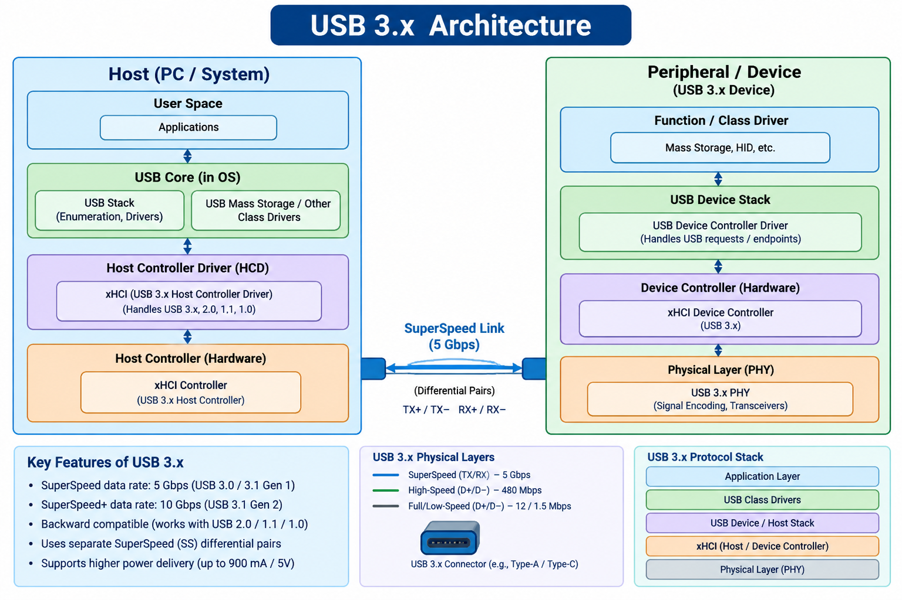

USB 3.x Mass Storage Device Driver

Linux Kernel Driver Development | USB 3.x (UAS + BOT)

A Linux kernel USB Mass Storage driver developed to understand and implement USB 3.x SuperSpeed communication, storage protocols, asynchronous data transfers, and block device integration.

This project explores how a USB storage device communicates with the Linux kernel, from USB enumeration and endpoint configuration to SCSI command processing and block-level read/write operations.

Overview

USB Mass Storage devices use transport protocols to exchange storage commands and data with the host.

This project implements two USB Mass Storage transport protocols:

USB Attached SCSI (UAS): A high-performance transport protocol designed for USB 3.x devices, supporting multiple outstanding commands and USB streams.
Bulk-Only Transport (BOT): A traditional USB Mass Storage transport protocol using Command Block Wrappers (CBW) and Command Status Wrappers (CSW).

The driver detects the supported interface, selects the appropriate transport protocol, communicates with the storage device, and registers the storage capacity as a Linux block device.

Key Features
Key Features
1. USB 3.x SuperSpeed Detection

    Detect USB 3.x SuperSpeed devices.
    Inspect USB device and interface descriptors.
    Read SuperSpeed capability information from the BOS descriptor.
    Display link speed and U1/U2 Link Power Management (LPM) status.
    Identify supported USB Mass Storage interfaces.

2. SuperSpeed Endpoint Configuration

    Identify UAS command, status, data IN, and data OUT endpoints.
    Parse UAS Pipe Usage descriptors.
    Inspect SuperSpeed Endpoint Companion Descriptor information.
    Read maximum burst and stream capabilities.
    Configure bulk endpoints for UAS communication.

3. USB Attached SCSI (UAS)

    Implement UAS command submission.
    Build and transfer Command Information Units (Command IUs).
    Handle SCSI command tags and USB stream IDs.
    Allocate and manage USB streams.
    Support asynchronous URB submission.
    Process command, data, and status completions.
    Handle concurrent storage requests.

4. Bulk-Only Transport (BOT)

    Implement Command Block Wrapper (CBW).
    Implement Command Status Wrapper (CSW).
    Handle command, data, and status phases.
    Validate BOT signatures and command tags.
    Implement BOT reset recovery.
    Support devices that do not provide UAS functionality.

5. SCSI Command Processing

The driver implements the following SCSI commands:
SCSI Command	Purpose
INQUIRY	Identify the storage device
TEST UNIT READY	Check device readiness
READ CAPACITY (10)	Retrieve storage capacity
READ (10)	Read storage blocks
WRITE (10)	Write storage blocks
6. Linux Block Layer Integration

    Integrate with the Linux block subsystem.
    Use the blk-mq multi-queue framework.
    Convert block requests into SCSI READ/WRITE commands.
    Translate Linux sector addresses into device LBAs.
    Handle scatter-gather request segments.
    Register a Linux block device.
    Support block-level read and write operations.

7. USB 3.x Power Management

    Support USB runtime power management.
    Handle USB suspend and resume.
    Support UAS stream restoration after USB reset.
    Manage interface power references during I/O.
    Provide a module parameter to disable hub-initiated U1/U2 transitions.

8. Error Handling and Recovery

    Handle USB transfer errors.
    Handle command and data transfer failures.
    Implement UAS request timeout handling.
    Process SCSI status and sense information.
    Handle device disconnection.
    Implement USB reset and recovery mechanisms.

The driver follows this communication architecture:

  

📂 Project Structure
text

usb-3x-mass-storage-driver/
├── Makefile

├── ums.h

├── ums_main.c

├── ums_bot.c

├── ums_uas.c

├── ums_scsi.c

└── ums_utils.c

<h2 align="center">USB 3.x Mass Storage Driver Flow</h2>

  

Building the Driver
Prerequisites
Linux operating system
Linux kernel headers
GCC compiler
Make
USB 3.x compatible host controller
USB Mass Storage device supporting UAS or BOT
1. Clone the Repository
bash
git clone <YOUR_GITHUB_REPOSITORY_URL>
cd usb-3x-mass-storage-driver

2. Create a Makefile
makefile
obj-m += usb_ms_combo.o

KDIR := /lib/modules/$(shell uname -r)/build
PWD := $(shell pwd)

all:
	$(MAKE) -C $(KDIR) M=$(PWD) modules

clean:
	$(MAKE) -C $(KDIR) M=$(PWD) clean

3. Compile the Kernel Module
bash
make

4. Load the Driver
bash
sudo insmod usb_ms_combo.ko

5. Check Kernel Logs
bash
sudo dmesg -w

6. Check the Registered Block Device
bash
lsblk

The driver registers its block devices using the naming convention:

text
/dev/usbms0
/dev/usbms1

7. Unload the Driver
bash
sudo rmmod usb_ms_combo

Module Parameters

The driver provides two configurable module parameters.

Parameter	Default	Description
disable_hub_lpm	0	Disables hub-initiated U1/U2 transitions when enabled
force_bot	0	Forces BOT instead of UAS when available
Load using BOT
bash
sudo insmod usb_ms_combo.ko force_bot=1

Load with hub-initiated LPM disabled
bash
sudo insmod usb_ms_combo.ko disable_hub_lpm=1

Check Driver Messages
bash
dmesg | grep "USB MS"

Important Implementation Details
UAS vs BOT
Feature	UAS	BOT
Transport	USB Attached SCSI	Bulk-Only Transport
Command handling	Asynchronous	Sequential
Multiple outstanding commands	Supported	Not supported by this implementation
USB Streams	Supported	Not used
Command IU	Yes	No
CBW/CSW	No	Yes
Queue depth	Multiple commands	1
Performance potential	Higher	Lower

The driver prefers UAS when:

The device provides a UAS interface.
The USB connection operates at SuperSpeed or faster.
UAS endpoints and USB streams can be configured successfully.

Otherwise, it attempts to use BOT when a BOT interface is available.

Learning Objectives

This project provides practical experience with:

Linux USB device driver development.
USB 3.x SuperSpeed architecture.
USB device enumeration and descriptors.
SuperSpeed Endpoint Companion Descriptors.
USB Link Power Management (U1/U2).
USB Attached SCSI protocol.
Bulk-Only Transport protocol.
USB streams and asynchronous URBs.
SCSI command processing.
Linux block device driver development.
blk-mq request processing.
Kernel memory management and synchronization.
USB error handling and reset recovery.
Linux runtime power management.
Current Limitations

This is an educational driver implementation, not a production-ready replacement for the Linux kernel's existing USB Mass Storage drivers.

Current limitations include:

Supports SCSI READ (10) and WRITE (10) for block I/O.
SCSI SYNCHRONIZE CACHE and FLUSH are not implemented.
READ CAPACITY (16) is not implemented.
Advanced UAS task management is not implemented.
UAS error recovery and device compatibility require further validation.
Filesystem management is handled by the Linux kernel, not by this driver.

Important: Test with disposable storage media or a virtual USB device. Do not use important data while validating an experimental storage driver.

Future Improvements
Implement SCSI SYNCHRONIZE CACHE.
Add READ CAPACITY (16) support.
Improve UAS task management and recovery.
Optimize asynchronous data transfers.
Improve error handling and device compatibility.
Add more comprehensive USB descriptor validation.
Validate SuperSpeed burst and stream performance.
Benchmark UAS against BOT.
Improve suspend/resume and reset handling.
Project Goal

The primary goal of this project is to understand how a USB 3.x Mass Storage device communicates with the Linux kernel and how a custom kernel driver can manage the complete storage communication path.

From USB enumeration to SCSI command execution, asynchronous data transfers, and block device registration, this project explores the important components involved in Linux USB Mass Storage driver development.

Author: 
Rahul Thumma

Linux Kernel Driver Development
USB 3.x | USB Mass Storage Device Driver
